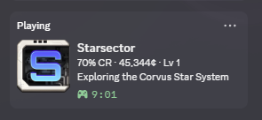
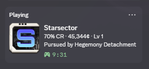
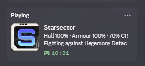

# discord-rp

A Starsector utility mod that shows what you're doing as your Discord status:





Works on Windows, Linux and macOS (including Flatpak and Snap Discord on Linux). 


## Building

Needs a JDK (17 or later) and a Starsector install. Create `local.properties`:

```
starsectorCore=C:/Games/Starsector/starsector-core
```

then run `gradlew.bat test jar`. The jar lands in `jars/discordrp.jar`. `gradlew.bat release` also
packs the release zip into `build/release/`; `gradlew.bat setVersion -Pv=0.2.0` bumps the version in
`mod_info.json` and `discordrp.version`.

## License

MIT, see [LICENSE](LICENSE).
